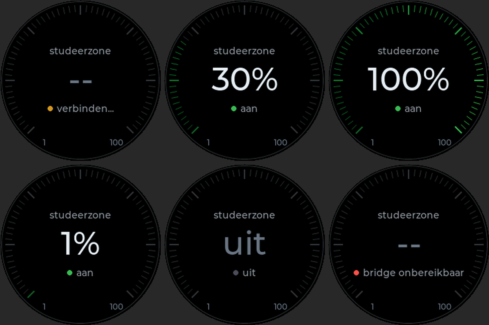

# esp32-rotary-hue-dimmer

A rotary dimmer for Philips Hue on the **Elecrow CrowPanel 1.28" Rotary Display**. The knob controls the `StudeerZone` directly through the Hue Bridge. Written in C with ESP-IDF and LVGL 9.



## Controls

| Lights | Action | Result |
|---|---|---|
| Off | Turn the ring | Nothing happens |
| Off | Press the button | On at 30% |
| On | Ring clockwise | Brighter, up to 100% |
| On | Ring counter-clockwise | Dimmer, down to 1%; the lights stay on |
| On | Press the button | Off |

Changes made in the Hue app also show up on the knob. The dot on the display shows the status: yellow is connecting, red is an error, green is on and grey is off.

The texts on the display are in Dutch: `aan` means on, `uit` means off and `verbinden...` means connecting.

## What you see

- **Wi-Fi symbol:** a small symbol at the top centre. Green with bars for the signal strength (3 from -60 dBm, 2 from -70, 1 from -80), dark red without Wi-Fi. It only shows the Wi-Fi; the connection to the bridge is shown by the dot.
- **LED ring in the base:** glows a soft green while the lights are on. If the lights are off or there is no connection to the bridge, the ring is off.

## Requirements

- ESP-IDF **v5.5.3**, for example through the ESP-IDF extension in VS Code
- A USB-C cable that carries data
- A 2.4 GHz Wi-Fi network from which the bridge can be reached

LVGL and the display driver are downloaded automatically on the first build.

## Setup

Copy `main/credentials.example.h` to `main/credentials.h` and fill in your details. This file is not committed to git. After a change you have to flash again.

To create a key, press the button on the bridge and run this within 30 seconds:

```bash
curl -sk -X POST https://172.16.100.4/api -d '{"devicetype":"hue_dimmer#esp32"}'
```

The value of `username` is the key.

## Build and flash

**In VS Code:** open this folder, choose target `esp32s3` and the board's port at the bottom, and click the flame icon (Build, Flash and Monitor).

**In the terminal or through Claude Code:**

```bash
. ~/.espressif/tools/activate_idf_v5.5.3.sh  # installed through EIM
ls /dev/cu.*                               # find the board's port
idf.py -p /dev/cu.YOUR_PORT flash monitor  # exit with Ctrl+]
```

Upload not working? Hold BOOT, briefly press RESET, release BOOT and try again.

## Changing settings

All choices are in `main/app_config.h`:

| Setting | Default | Meaning |
|---|---|---|
| `DIM_ON_PERCENT` | 30 | Brightness after switching on |
| `DIM_STEP_PERCENT` | 2 | Percent per click of the ring |
| `HUE_ZONE_NAME` | `StudeerZone` | Exact name in the Hue app |
| `HUE_SEND_INTERVAL_MS` | 500 | Minimum time between two commands |
| `ENCODER_COUNTS_PER_STEP` | 4 | Counts per tactile click |
| `ENCODER_REVERSE` | 0 | Set to 1 if the direction is reversed |
| `BACKLIGHT_PERCENT` | 60 | Brightness of the display |
| `WIFI_ICON_INTERVAL_MS` | 3000 | How often the signal strength is measured again |
| `BASE_LED_GREEN` | 10 | Brightness of the green in the LED ring, 0 to 255 |

The background colour is `C_BACKGROUND` in `main/ui.c`. Use `0x0d1117` for the GitHub shade. That file also holds the colours of the Wi-Fi symbol (`C_WIFI_ON`, `C_WIFI_OFF`) and the thresholds for the bars (`WIFI_RSSI_1` to `WIFI_RSSI_3`).

## Structure

| File | Contents |
|---|---|
| `main/main.c` | Start-up and the main loop |
| `main/dimmer.c` | The control rules |
| `main/input.c` | Ring and push button |
| `main/ui.c` | The display |
| `main/display_port.c` | Display driver and the LVGL task |
| `main/wifi.c` | Wi-Fi and signal strength |
| `main/base_leds.c` | LED ring in the base (5 WS2812 LEDs on GPIO 48) |
| `main/hue.c` | Requests to the bridge and the event stream |
| `main/hue_json.c`, `main/hue_sse.c` | Parsing the responses and the event stream |
| `sdkconfig.defaults` | Fixed settings for PSRAM, flash, TLS, Wi-Fi and fonts |

LVGL is not thread-safe: a call from outside the LVGL task must sit between `display_lock()` and `display_unlock()`.

## Known limitations of version 1

- **Certificate:** the firmware does not verify the bridge's certificate yet. Your Python app doesn't do that either (`verify=False`). The connection is encrypted, but another device on your network could pose as the bridge and so see the key.
- **Touch:** not used yet.
- **Settings:** Wi-Fi and key are fixed in the firmware.

## Troubleshooting

| On the display | Meaning | Fix |
|---|---|---|
| Yellow, `verbinden...` (connecting) | No Wi-Fi yet, or first contact | Check `WIFI_SSID` and `WIFI_PASSWORD`, and that the network is 2.4 GHz |
| Wi-Fi symbol dark red | No Wi-Fi | Check `WIFI_SSID` and `WIFI_PASSWORD`, and that the network is 2.4 GHz |
| Red, `bridge onbereikbaar` (bridge unreachable) | No connection to the bridge | Check `HUE_BRIDGE_IP` and whether the Wi-Fi network can reach the bridge |
| Red, `sleutel geweigerd` (key rejected) | The key is wrong | Check `HUE_APP_KEY` |
| Red, `zone niet gevonden` (zone not found) | The name does not exist on the bridge | Check `HUE_ZONE_NAME`; capitals matter |
| Mirrored text | Display mirroring is wrong | Adjust `esp_lcd_panel_mirror` in `main/display_port.c` |
| Ring works the wrong way round | Direction of rotation | Set `ENCODER_REVERSE` to 1 |
| Ring dims too fast or too slowly | Different count per click | Adjust `ENCODER_COUNTS_PER_STEP` (for example to 2) |
